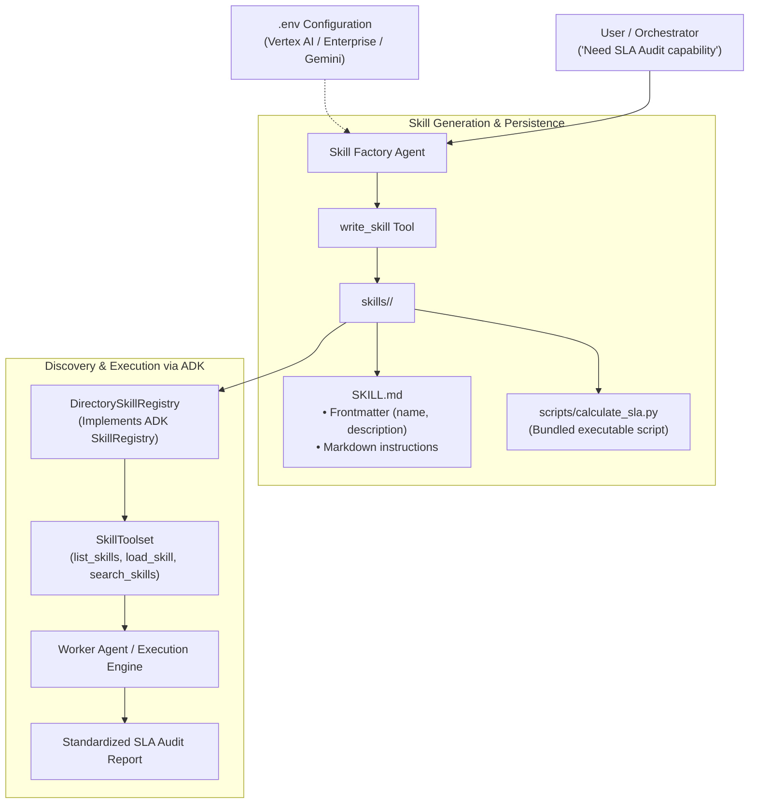

# Google ADK — Self-Authoring Skill Factory

A simple, modular demonstration showing how an agent using the **Google Agent Development Kit (ADK)** can dynamically generate, validate, write, and immediately execute a new skill by itself using `.env` configuration.

---

## 🎯 Overview

In standard workflows, agent skills (`SKILL.md`) are hand-authored by developers before deployment. This sample demonstrates a **Self-Authoring Skill Factory**:

1. **Skill Factory Agent**: Receives a task requirement or capability gap and synthesizes a complete skill specification.
2. **Autonomous Authoring**: Using the `write_skill` tool, the agent persists a standard ADK `SKILL.md` (Level 1 YAML frontmatter + Level 2 Markdown instructions) along with optional Level 3 bundled Python scripts (`scripts/`).
3. **Dynamic Discovery**: A `DirectorySkillRegistry` dynamically detects newly minted skills on the fly.
4. **Immediate Consumption**: A worker agent equipped with ADK's native `SkillToolset` (`list_skills`, `load_skill`, `run_skill_script`, `search_skills`) searches for and executes the newly generated skill.

---

## ⚙️ Environment Configuration (`.env`)

All configurations and credentials are read automatically from your local `.env` file via `python-dotenv`:

```bash
# Option 1: Vertex AI / Google Cloud (Enterprise)
GOOGLE_GENAI_USE_ENTERPRISE=1
GOOGLE_CLOUD_PROJECT=your-google-cloud-project-id
GOOGLE_CLOUD_LOCATION=us-central1

# Option 2: Direct Gemini API Key (Alternative)
# GEMINI_API_KEY=your_gemini_api_key_here
```

---

## 🏗️ Architecture



---

## 📁 Repository Structure

```
generateskill_agent/
├── .env                 # Your local configuration (Vertex AI or Gemini API key)
├── .env.example         # Template for environment settings
├── skill_factory.py     # Core implementation: write_skill tool, Registry, and Agents
├── demo.py              # End-to-end demonstration using .env configuration
├── agent_live.py        # Interactive runner with live ADK agent and .env
├── requirements.txt     # Dependencies (google-adk, pyyaml, python-dotenv)
├── README.md            # Documentation and guide
└── skills/              # Target folder where generated skills are saved
    └── sla-auditor/     # Generated by the Skill Factory during the demo
        ├── SKILL.md
        └── scripts/
```

---

## 🚀 Quick Start

### 1. Install Dependencies
```bash
pip install -r requirements.txt
```

### 2. Configure `.env`
Ensure your `.env` contains your project settings:
```ini
GOOGLE_GENAI_USE_ENTERPRISE=1
GOOGLE_CLOUD_PROJECT=project-247cb656-8ea6-47ef-a6f
GOOGLE_CLOUD_LOCATION=us-central1
```

### 3. Run the Demonstration
Execute the demonstration:
```bash
python demo.py
```

### 4. Interactive Live Agent Run
To have the Skill Factory create a new skill interactively using live LLM reasoning:
```bash
python agent_live.py
```
