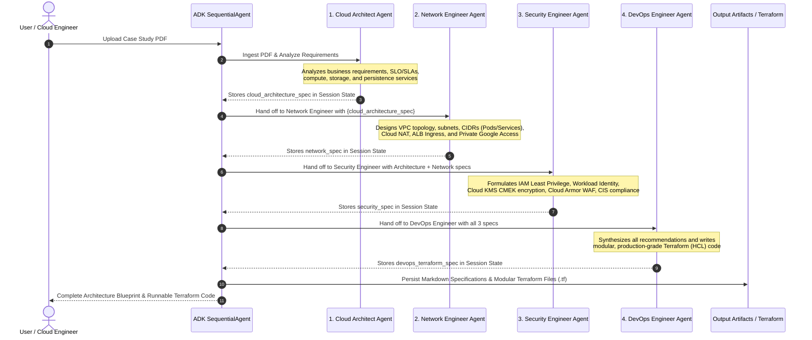

# Multi-AI Agent System for Cloud Infrastructure Design & Automation

An enterprise-grade, sequential multi-AI agent system built with the **Google Agent Development Kit (ADK)**. 

Upon uploading a case study PDF, the system coordinates four specialized agents implemented using the `LlmAgent` class, orchestrated strictly in sequence by a `SequentialAgent` root class:

```
┌────────────────────────┐      ┌────────────────────────┐      ┌────────────────────────┐      ┌────────────────────────┐
│  Cloud Architect Agent │ ───► │ Network Engineer Agent │ ───► │ Security Engineer Agent│ ───► │ DevOps Engineer Agent  │
│  (Overall Architecture)│      │  (Topology & Routing)  │      │ (Hardening & Compliance│      │   (Terraform IaC)      │
└────────────────────────┘      └────────────────────────┘      └────────────────────────┘      └────────────────────────┘
```

> **🌐 Live Cloud Run Deployment:**  
> **Service URL:** [https://multiagent-cloud-infra-739157543705.us-central1.run.app](https://multiagent-cloud-infra-739157543705.us-central1.run.app)  
> **Region:** `us-central1` | **Access:** Public (Unauthenticated)  
> **Features:** Interactive Web UI, drag-and-drop PDF upload, stage-by-stage visualization, preloaded sample case study, and one-click Terraform `.zip` package download.


---

## 🏗️ Architecture Overview

The multi-agent system processes enterprise architecture requirements through progressive refinement and state passing:



---

## 🤖 The Four Specialized Agents

Each agent is an instance of `google.adk.agents.LlmAgent`, specialized in a distinct cloud engineering domain:

| Agent | ADK Class | Core Responsibility | Output State Key |
|---|---|---|---|
| **Cloud Architect Agent** | `LlmAgent` | Analyzes business and technical requirements from the uploaded case study PDF; defines target cloud architecture, HA/DR (RTO/RPO), compute tiers (GKE/Cloud Run), and persistence models. | `cloud_architecture_spec` |
| **Network Engineer Agent** | `LlmAgent` | Defines VPC topology, subnet CIDR planning (Primary and Secondary for GKE Pods/Services), Cloud NAT, Private Service Connect (PSC), Cloud Armor ALB Ingress, and routing. | `network_spec` |
| **Security Engineer Agent** | `LlmAgent` | Formulates infrastructure hardening, IAM Least Privilege, GKE Workload Identity, Cloud KMS CMEK encryption (90-day rotation), VPC-SC, Cloud Armor WAF rules, and CIS/SOC2/PCI-DSS compliance. | `security_spec` |
| **DevOps Engineer Agent** | `LlmAgent` | Implements all architectural, networking, and security specifications as production-ready, modular **Terraform (HCL)** code (`versions.tf`, `variables.tf`, `vpc.tf`, `security.tf`, `compute.tf`, `database.tf`, `outputs.tf`). | `devops_terraform_spec` |

### Orchestration: SequentialAgent
The pipeline is governed by `google.adk.agents.SequentialAgent`:
```python
root_agent = SequentialAgent(
    name="cloud_infrastructure_pipeline",
    description="Sequential multi-agent infrastructure design and Terraform generation pipeline.",
    sub_agents=[
        cloud_architect_agent,
        network_engineer_agent,
        security_engineer_agent,
        devops_engineer_agent,
    ],
)
```

---

## 📁 Project Structure

```text
multiagent/
├── app/
│   ├── __init__.py               # App package exposing root_agent and app
│   ├── agent.py                  # Defines SequentialAgent root_agent orchestrator
│   ├── config.py                 # Configuration loader (GCP project, Gemini model)
│   ├── agents/                   # Specialized LlmAgents
│   │   ├── __init__.py
│   │   ├── cloud_architect.py    # Cloud Architect Agent
│   │   ├── network_engineer.py   # Network Engineer Agent
│   │   ├── security_engineer.py  # Security Engineering Agent
│   │   └── devops_engineer.py    # DevOps Engineering Agent (Terraform IaC)
│   └── tools/
│       ├── __init__.py
│       └── pdf_loader.py         # PDF text extraction & native multimodal Part builder
├── tests/
│   ├── __init__.py
│   └── test_multiagent_pipeline.py # Unit tests for classes, ordering, and PDF handling
├── output_artifacts/             # Generated specs & extracted Terraform code
│   ├── 01_cloud_architecture_spec.md
│   ├── 02_network_topology_spec.md
│   ├── 03_security_hardening_spec.md
│   ├── 04_devops_terraform_spec.md
│   └── terraform/                # Modular .tf files ready for `terraform init`
│       ├── versions.tf
│       ├── variables.tf
│       ├── vpc.tf
│       ├── security.tf
│       ├── compute.tf
│       ├── database.tf
│       ├── outputs.tf
│       └── terraform.tfvars.example
├── create_sample_pdf.py          # Script generating sample_case_study.pdf
├── sample_case_study.pdf         # Enterprise Core Banking case study PDF
├── run_pipeline.py               # CLI runner to execute the sequential pipeline
├── pyproject.toml                # Project packaging and metadata
├── requirements.txt              # Python dependencies
├── .env                          # Environment variables configuration
└── .env.example                  # Template configuration
```

---

## 🚀 Getting Started

### 1. Prerequisites
- Python 3.10+
- Google Cloud Platform project with Vertex AI API enabled (or Google AI Studio Gemini API Key)
- Google Cloud authentication configured (`gcloud auth application-default login`)

### 2. Installation
Install project dependencies:
```bash
pip install -r requirements.txt
```

### 3. Environment Configuration
Create or configure `.env`:
```env
GOOGLE_GENAI_USE_VERTEXAI=True
GOOGLE_CLOUD_PROJECT=your-gcp-project-id
GOOGLE_CLOUD_LOCATION=us-central1
DEFAULT_LLM_MODEL=gemini-2.5-flash
```
*(Alternatively, set `GEMINI_API_KEY=your_key_here` if using Google AI Studio).*

---

## 💻 Running the System

### Option A: Command-Line Runner (Recommended)
Run the complete multi-agent pipeline on a case study PDF:
```bash
# Run on the included enterprise case study PDF
python3 run_pipeline.py --pdf sample_case_study.pdf

# Or run on any custom PDF
python3 run_pipeline.py --pdf /path/to/your_case_study.pdf --output-dir custom_output/
```

This will:
1. Load the PDF as a native multimodal input to the pipeline.
2. Stream output step-by-step through each agent:
   - **Step 1/4**: Cloud Architect Agent
   - **Step 2/4**: Network Engineer Agent
   - **Step 3/4**: Security Engineering Agent
   - **Step 4/4**: DevOps Engineering Agent
3. Save Markdown reports and extract modular `.tf` Terraform files into `output_artifacts/terraform/`.

---

### Option B: ADK Interactive Web UI / Playground
You can launch the built-in ADK Web Server:
```bash
adk web .
```
Navigate to `http://127.0.0.1:8000` to interact with the agent in a web chat interface, where you can directly attach case study PDFs and inspect session history.

---

### Option C: ADK CLI Single-Turn
```bash
adk run app "Attached is sample_case_study.pdf. Please design our cloud infrastructure."
```

---

## 🧪 Running Tests

The test suite validates agent class inheritance, sequence order, output state keys, and PDF loading:
```bash
python3 -m pytest -v tests/
```

---

## 📦 Output Artifacts & Terraform Deployment

After running the pipeline, deploy the generated Terraform code:
```bash
cd output_artifacts/terraform/
cp terraform.tfvars.example terraform.tfvars
# Update terraform.tfvars with your GCP project_id and desired region

terraform init
terraform plan
terraform apply
```
